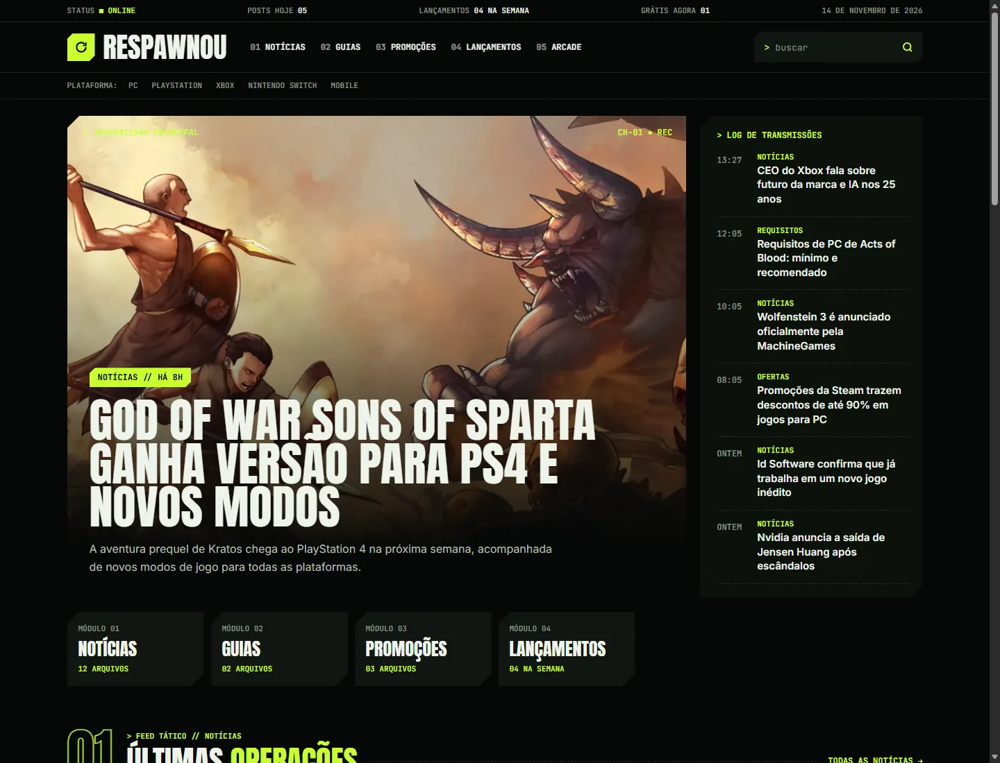
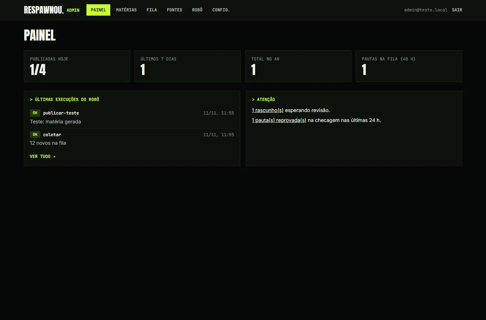
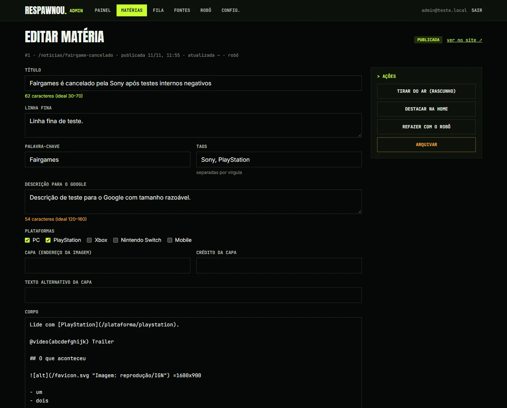
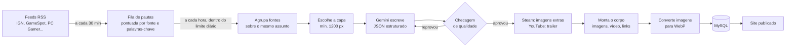

# Respawnou

**Portal de notícias de games em português que se escreve sozinho.**

Um robô lê os principais sites de games do mundo, escolhe as pautas, escreve a matéria em português
com IA, monta imagens, vídeo e links, confere a qualidade e publica — várias vezes por dia, sem
ninguém apertar um botão.

[**respawnou.com.br**](https://respawnou.com.br)

> [!IMPORTANT]
> **Todos os direitos reservados.**
> O código está público apenas para leitura. Não é um projeto open source:
> não é permitido copiar, redistribuir, publicar outra versão do site nem reaproveitar o código, o
> visual ou os textos, no todo ou em parte. Veja [LICENSE](LICENSE).

## O que é

O Respawnou é um site de notícias de games para o público brasileiro (PC, PlayStation, Xbox,
Nintendo Switch e mobile). O diferencial é a **redação automática**: o conteúdo é produzido por um
pipeline editorial que roda no próprio servidor, e o dono só acompanha pelo painel administrativo.

O projeto foi feito de ponta a ponta por mim — produto, design, frontend, backend, banco de dados,
automação, SEO e deploy — e está em produção.

### Destaques

- **Robô editorial com IA** — coleta, pontuação de pautas, escrita com o Gemini, checagem de
  qualidade com até 3 tentativas de correção, enriquecimento com imagens e trailer, e publicação.
- **SEO de verdade** — renderização no servidor (SSR), dados estruturados (`NewsArticle`,
  `WebSite`), Open Graph, sitemap e RSS dinâmicos, imagens WebP próprias, links internos automáticos,
  e páginas vazias fora do índice do Google.
- **Painel `/admin`** — editar e republicar matérias, controlar a fila de pautas e as fontes, rodar o
  robô sob demanda e ver o histórico de execuções.
- **Arcade próprio** — jogos de passatempo infinitos feitos do zero em canvas, sem biblioteca
  (corredor, nave, torre de blocos, quebra-blocos, cobrinha, junta-três), que rodam no celular e no teclado, com recorde salvo
  no navegador.
- **Design próprio** — o tema "Central de Comando" (HUD de jogo: cantos chanfrados, tipografia
  condensada, verde-limão sobre preto), responsivo de 375 px a telas largas.
- **Pronto para monetizar** — AdSense com Modo de Consentimento v2, banner de cookies (LGPD),
  `ads.txt` e políticas legais completas, tudo ligado por uma única variável de ambiente.

## Telas

| Matéria | Celular |
|---|---|
|  |  |

| Painel administrativo | Editor de matéria |
|---|---|
|  |  |

As telas do painel usam dados de teste.

## Como o robô funciona

1. **Coleta** (`/api/cron/coletar`, a cada 30 min): lê ~15 feeds, descarta o que não é notícia
   (ofertas de varejo, listas patrocinadas), deduplica e pontua cada item.
2. **Publicação** (`/api/cron/publicar`, de hora em hora): pega a pauta de maior pontuação, junta
   outras fontes sobre o mesmo assunto e escolhe uma capa com resolução suficiente — sem imagem boa,
   a pauta é pulada.
3. **Escrita**: o Gemini recebe as fontes e um guia editorial (tom, estrutura, tamanho, links
   permitidos) e devolve a matéria em JSON tipado.
4. **Checagem**: título e descrição no tamanho certo, número mínimo de palavras, intertítulos, links
   só para domínios permitidos, sem frases proibidas nem boatos tratados como fato. Se reprovar, a
   lista de problemas volta para o modelo (até 3 tentativas).
5. **Enriquecimento e montagem**: capturas da Steam para ilustrar os intertítulos, trailer pelo
   YouTube Data API, crédito em toda imagem, "Leia também" com matérias relacionadas.
6. **Mídia própria**: as imagens são baixadas, convertidas para WebP (até 1600 px) e servidas pelo
   próprio site.

O robô **respeita bloqueios**: se um site responde 403 ou recusa a conexão, a fonte é desativada —
nada de se passar por navegador.

## Stack

| Camada | Tecnologia |
|---|---|
| Frontend | React 19, React Router 8 (modo framework, SSR), Tailwind CSS 4, TypeScript |
| Servidor | Node.js 24, Express 5 |
| Banco | MySQL (`mysql2`), migrations SQL versionadas e aplicadas no start |
| IA | Google Gemini (com cadeia de modelos de reserva) |
| Mídia | `sharp` (WebP), Steam Store API, YouTube Data API v3 |
| Hospedagem | Hostinger (app Node.js + MySQL + Cron Jobs), deploy automático a cada push |

## Decisões técnicas

Algumas escolhas que valem a explicação (o registro completo está em
[`docs/decisoes.md`](docs/decisoes.md)):

- **Jobs em segundo plano por causa da CDN.** A CDN da hospedagem corta qualquer requisição acima de
  ~55 s, e escrever uma matéria pode levar mais. As rotas do robô respondem `202` na hora, o trabalho
  segue em segundo plano e o resultado fica gravado no banco (`cron_runs`), visível no painel.
- **Qualidade antes de volume.** O AdSense reprova sites com conteúdo raso ou reescrito. Por isso cada
  matéria passa por regras objetivas, cita as fontes com link e é descartada se não houver imagem
  boa — melhor publicar menos do que publicar mal.
- **Nenhuma página vazia.** Editoria, plataforma ou calendário sem conteúdo some do menu, da home e do
  sitemap e recebe `noindex`, até ter matérias.
- **Sem segredos no código.** Chaves e senhas ficam só nas variáveis de ambiente da hospedagem; a
  senha do painel nunca é guardada, só o hash scrypt.
- **Uma camada de dados, duas fontes.** As páginas não sabem se os dados vêm do MySQL ou dos dados de
  exemplo, o que permite desenvolver o frontend sem banco.

## Documentação

A pasta [`docs/`](docs/README.md) tem o status do projeto e os detalhes de cada parte:
[arquitetura](docs/arquitetura.md) · [banco de dados](docs/banco-de-dados.md) ·
[automação](docs/automacao.md) · [painel](docs/admin.md) · [AdSense](docs/adsense.md) ·
[deploy](docs/deploy-hostinger.md) · [decisões](docs/decisoes.md)

## Licença

© 2026 Respawnou. **Todos os direitos reservados.** Este repositório é público só para leitura.
Nenhuma licença de uso, cópia, modificação ou distribuição é concedida. As marcas e
imagens de jogos citadas no site pertencem aos seus donos. Detalhes em [LICENSE](LICENSE).
